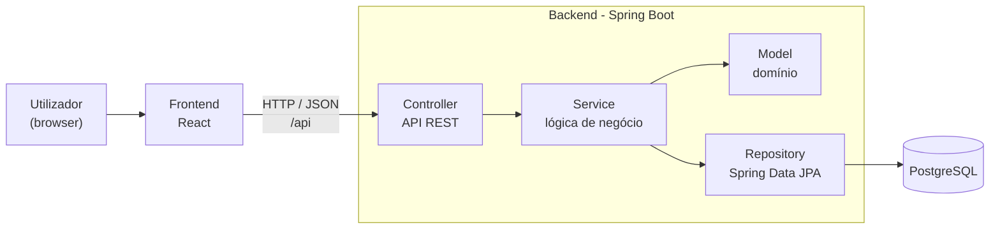

# Arquitetura Inicial — StudyMatch

Proposta de arquitetura para o Sprint 1. Vai evoluir à medida que surgirem novos requisitos.

## 1. Diagrama

## 2. Componentes e responsabilidades

| Componente | Responsabilidade | Depende de |
|---|---|---|
| **Frontend (React)** | Interface do utilizador. Apresenta dados e envia pedidos à API. Não contém regras de negócio. | API REST |
| **Controller** | Expõe os endpoints REST, valida o formato dos pedidos e traduz erros em códigos HTTP. | Service |
| **Service** | Contém a lógica de negócio e as regras do domínio (ex.: cálculo do perfil, cold start, score de compatibilidade). | Model, Repository |
| **Model** | Entidades e conceitos do domínio, com as suas invariantes. | — |
| **Repository** | Acesso aos dados (Spring Data JPA). Isola o resto da aplicação da base de dados. | Base de dados |
| **Base de dados (PostgreSQL)** | Armazenamento persistente. | — |

As dependências apontam sempre para dentro: o frontend depende da API, os controllers dos serviços, os serviços do modelo e dos repositórios. Um controller nunca acede diretamente a um repository.

## 3. Comunicação entre frontend e backend

- API **REST** com mensagens em **JSON**, sob o prefixo `/api`.
- Em desenvolvimento, o servidor do frontend (Vite) reencaminha os pedidos `/api` para o backend (`localhost:8080`), evitando problemas de CORS.
- Códigos HTTP usados: `200` (sucesso), `201` (criado), `400` (pedido inválido), `409` (conflito), `404` (não encontrado).

## 4. Persistência

- **Spring Data JPA** com **PostgreSQL**.
- O esquema é gerado a partir das entidades nesta fase (`ddl-auto=update`). Quando o modelo estabilizar, passa-se a migrações versionadas (ex.: Flyway).
- Perfil `h2` (base de dados em memória) disponível para desenvolver e testar sem instalar PostgreSQL.
- PostgreSQL de desenvolvimento via `docker-compose.yml`.

## 5. Onde residem as regras de negócio

- **Service e Model.** Validações de domínio (nota entre 0 e 20, número de aluno único, pesos entre 0 e 1) e cálculos (perfil, confiança, compatibilidade).
- **Controller:** apenas validação de formato (campos obrigatórios).
- **Frontend:** apenas validações de conveniência para o utilizador; o backend valida sempre.

## 6. Preparação para a mudança

- A lógica de perfil e de matching fica isolada em serviços, para poder trocar fórmulas, pesos ou estratégias sem alterar a API nem a persistência.
- As competências e os seus pesos são dados, não código, para serem configuráveis.
- A estrutura de pacotes por camada facilita acrescentar funcionalidades (ex.: formação de grupos) sem reestruturar o projeto.
