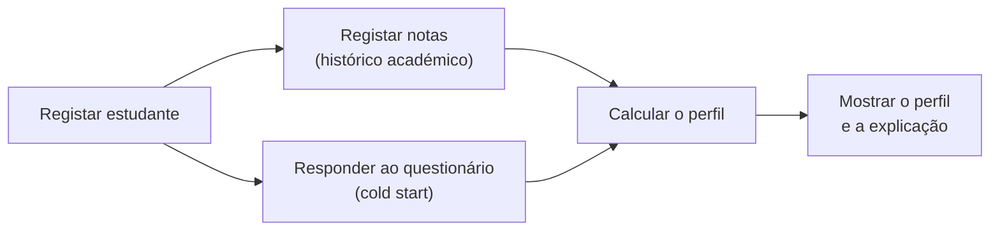
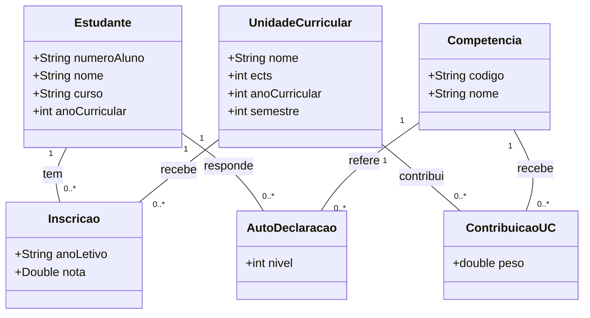
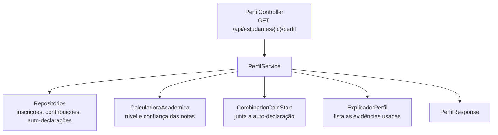

# Decisões de Design — Sprint 2

Perfil do estudante, histórico académico e cold start. Este documento regista as decisões do Sprint 2, a sua justificação e as alternativas consideradas. Complementa [`DECISIONS.md`](../DECISIONS.md) (stack) e [`arquitetura.md`](arquitetura.md).

## 1. Âmbito do sprint

O Sprint 2 constrói o subsistema de **perfil do estudante**: representar estudantes, o seu percurso académico e as suas competências, e tratar o caso de um estudante **sem histórico** (cold start). A formação automática de grupos fica para sprints seguintes; o perfil é a sua base.

Fluxo implementado de ponta a ponta:

## 2. Decisões e justificação

| # | Decisão | Justificação | Alternativa considerada |
|---|---|---|---|
| D1 | O perfil é **calculado a cada pedido** e não é guardado na base de dados | Reflete sempre as notas atuais; atualiza-se sozinho quando entra uma nota; evita inconsistências e simplifica os testes | Guardar o perfil e recalculá-lo a cada alteração: mais rápido de ler, mas exige manter os dois sincronizados |
| D2 | **5 competências** guardadas na base de dados (Programação, Bases de Dados, Desenvolvimento Web, Algoritmos, Engenharia de Software) | Suficientes para um perfil útil e demonstrável; configuráveis sem alterar código | Lista fixa no código: mais simples, mas não é configurável |
| D3 | Cada UC contribui para cada competência com um **peso entre 0 e 1** | Uma UC como Compiladores contribui para mais de uma competência, e com intensidades diferentes | Associação simples UC → competência, sem pesos |
| D4 | Só contam notas **≥ 10**; por UC conta a **melhor nota aprovada** | Trata repetições e melhorias de nota; uma reprovação não deve baixar o perfil de quem depois aprovou | Usar sempre a última nota, ou a média das tentativas |
| D5 | **Confiança** por competência, que cresce com a quantidade de evidência | Distingue "80 com uma nota" de "80 com cinco notas" | Mostrar só o nível |
| D6 | **Cold start híbrido**: questionário de auto-declaração + dados institucionais | Decisão do Sprint 1. Aproveita informação que o sistema já tem e permite um perfil útil desde o primeiro dia | Perfil neutro ou diagnóstico inicial |
| D7 | Cada competência tem uma **origem**: académica, auto-declarada, mista ou desconhecida | Transparência: percebe-se de onde vem cada valor | Não distinguir a origem |
| D8 | Funcionalidade própria: **explicação do perfil** ("Porquê este valor?") | Transparência e confiança; reutiliza o cálculo, por isso custa pouco | Pesquisa e filtro de estudantes, importação CSV |
| D9 | As regras de cálculo vivem em classes **sem dependência da base de dados** (`CalculadoraAcademica`, `CombinadorColdStart`, `ExplicadorPerfil`) | Testáveis com testes unitários simples; fáceis de alterar quando mudarem os requisitos | Lógica dentro do serviço que acede à base de dados |

## 3. Modelo de dados do histórico académico

Restrições na base de dados: uma inscrição por (estudante, UC, ano letivo); uma auto-declaração por (estudante, competência); uma contribuição por (UC, competência); número de aluno e código de competência únicos.

Alterações face ao modelo de domínio do Sprint 1:
- O `PerfilAcademico` **deixou de ser uma entidade guardada**. O perfil é calculado a cada pedido (D1).
- A origem `MISTA` foi acrescentada às origens da evidência.
- Uma repetição de UC é uma nova `Inscricao` noutro ano letivo (a tentativa deixou de ser um atributo).

## 4. Cálculo do perfil

Para cada competência:

| Elemento | Regra |
|---|---|
| Evidência | Inscrições com nota ≥ 10 em UCs que contribuem (peso > 0). Por UC, a melhor nota |
| **Nível** | Média ponderada de `nota / 20 × 100` pelos pesos das contribuições (0 a 100) |
| **Confiança académica** | `min(1, soma dos pesos / 3)` (0 a 1) |
| Sem evidência | Nível nulo e confiança 0 (competência desconhecida) |
| **Maturidade do perfil** | Média das confianças académicas das 5 competências |

**Exemplo:** notas BD 16, AED 14 e LTW 18 dão BD 80, PROG 77,5 (`(0,5×70 + 0,3×90) / 0,8`), ALG 70, WEB 90, ES desconhecida e maturidade 0,25.

## 5. Estratégia de cold start

**Problema:** como construir um perfil útil quando ainda não há notas.

**Estratégia:**
1. O estudante responde a um **questionário** com o nível percebido (1 a 5) em cada competência. Pode deixar competências em branco.
2. A auto-declaração vale `nível × 20` e tem **confiança 0,4** (inferior à da evidência académica, porque é subjetiva).
3. Quando já existem notas, as duas fontes **combinam-se** por média pesada, em que o peso da auto-declaração é `0,4 × (1 − confiança académica)`.

**Transição para evidência académica:**

| Confiança académica | Peso da auto-declaração |
|---|---|
| 0 | 0,40 |
| 0,33 (uma UC de peso 1) | 0,27 |
| 0,67 | 0,13 |
| 1 (três UCs de peso 1) | 0 |

A influência do cold start **diminui sozinha** à medida que há notas e desaparece quando há evidência suficiente. Não é preciso nenhuma ação manual.

| Situação | Origem | Confiança |
|---|---|---|
| Sem notas nem questionário | Desconhecida | 0 |
| Só questionário | Auto-declarada | 0,40 |
| Só notas | Académica | A calculada |
| Notas e questionário | Mista | `peso académico + peso da auto-declaração` |
| Notas com confiança 1 | Académica | 1 |

**Limitação conhecida:** a auto-declaração depende da honestidade e do autoconhecimento do estudante. Por isso tem confiança baixa e perde peso quando há dados reais.

## 6. Funcionalidade própria: explicação do perfil

Cada competência tem um botão **"Porquê este valor?"** que lista as evidências usadas: as notas (UC, nota e peso) e, se existir, a auto-declaração com o seu peso.

**Valor para o produto:** a formação de grupos influencia a experiência dos estudantes. Um perfil explicável permite ao estudante detetar dados errados e ao docente justificar decisões. A explicação usa **exatamente os mesmos valores** do cálculo (há um teste que o confirma).

## 7. Arquitetura do cálculo

O `PerfilService` só **orquestra**: as regras estão nas três classes de cálculo, que não acedem à base de dados.

## 8. Estratégia de testes

| Área | Exemplos de regras testadas |
|---|---|
| Perfil académico | Nota 10 conta; nota 9 não conta; melhor nota por UC; confiança com teto em 1; peso zero; notas e pesos inválidos |
| Cold start | Só auto-declaração; transição para mista; auto-declaração ignorada com confiança 1; peso decrescente; níveis inválidos |
| Explicação | Lista as notas e a auto-declaração; reproduz o nível calculado |
| Serviços | Número de aluno duplicado; inscrição duplicada; nota inválida; competência inexistente |
| Persistência | Unicidades na base de dados; pesquisa por estudante |

Cobertura do mínimo do enunciado: cenário normal, cenário inválido, condição-limite, regra do perfil e regra do cold start.

## 9. Limitações e evolução

- O perfil é recalculado a cada pedido; se o volume crescer, pode passar a guardar-se em cache.
- Os pesos e as competências estão nos dados iniciais; falta uma interface para os editar.
- O Sprint 3 pode usar este perfil como entrada do **matching** (score ponderado), já decidido no Sprint 1.
