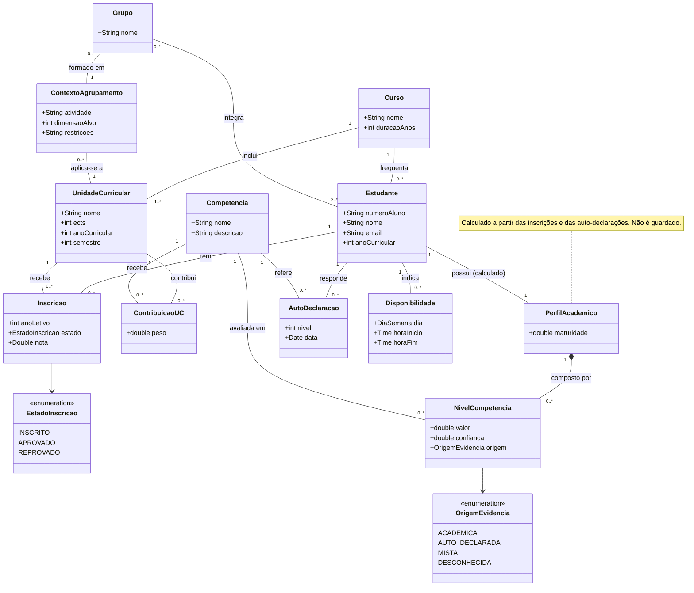

# Modelo de Domínio Inicial — StudyMatch

Modelo conceptual do domínio, derivado dos casos de uso (ver [`casos-de-uso.md`](casos-de-uso.md)). Representa conceitos do domínio, não detalhes de implementação (controllers, repositories, tabelas).

> **Atualizado no Sprint 2:** o perfil passa a ser calculado e não guardado; a origem de uma competência pode ser `MISTA`; repetir uma UC é uma nova inscrição. Ver [`design-sprint2.md`](design-sprint2.md).

## 1. Diagrama de classes

## 2. Descrição dos conceitos

| Conceito | Descrição |
|---|---|
| **Estudante** | Pessoa inscrita num curso, identificada pelo número de aluno. |
| **Curso** | Programa de estudos. Agrupa unidades curriculares e estudantes. |
| **UnidadeCurricular (UC)** | Disciplina do curso, com ECTS, ano e semestre. |
| **Inscricao** | Inscrição de um estudante numa UC num ano letivo. Guarda o resultado. Repetir uma UC cria uma nova inscrição, noutro ano letivo, que não substitui a anterior. |
| **Competencia** | Característica relevante para trabalho em grupo (ex.: programação, bases de dados, comunicação). Configurável. |
| **ContribuicaoUC** | Liga uma UC a uma competência, com um peso entre 0 e 1. É a forma como a evidência académica se transforma em competências. |
| **PerfilAcademico** | Resumo das competências de um estudante. **É calculado sempre que é pedido, a partir das inscrições e das auto-declarações, e não é guardado.** Tem um indicador de **maturidade** (quanta evidência existe), central para o cold start. |
| **NivelCompetencia** | Nível de uma competência no perfil, com **confiança** e **origem** (académica, auto-declarada, mista ou desconhecida). |
| **AutoDeclaracao** | Resposta do estudante no questionário de cold start (nível 1 a 5 numa competência). |
| **Disponibilidade** | Período semanal em que o estudante está disponível para trabalhar em grupo. |
| **ContextoAgrupamento** | Situação em que serão formados grupos: UC, atividade, tamanho alvo e restrições. |
| **Grupo** | Conjunto de estudantes formado num contexto. *Conceito já previsto, mas só será implementado em sprints futuros.* |

### Origem de uma competência

| Origem | Significado |
|---|---|
| `DESCONHECIDA` | Sem notas e sem auto-declaração. Nível desconhecido e confiança 0. |
| `AUTO_DECLARADA` | Só auto-declaração. Nível = valor declarado × 20, confiança 0,4. |
| `ACADEMICA` | Só evidência académica, ou notas com confiança académica 1 (a auto-declaração tem peso 0). |
| `MISTA` | Evidência académica e auto-declaração combinadas numa média pesada. |

## 3. Restrições de domínio

| Restrição | Regra |
|---|---|
| Número de aluno | Único e obrigatório. |
| Ano curricular | Entre 1 e a duração do curso. |
| Nota | Entre 0 e 20; aprovação a partir de 10. |
| Inscrição | Um estudante não tem duas inscrições na mesma UC no mesmo ano letivo; repetir a UC noutro ano letivo cria uma nova inscrição. |
| Peso de contribuição | Entre 0 e 1. |
| Auto-declaração | Nível entre 1 e 5. |
| Confiança | Entre 0 e 1; zero quando a competência é desconhecida. |
| Maturidade do perfil | Entre 0 e 1; cresce com a evidência académica disponível. |
| Dimensão alvo do grupo | Pelo menos 2. |

## 4. Como o modelo suporta o cold start e o matching

- **Cold start:** um estudante novo tem um `PerfilAcademico` com baixa maturidade. Os seus `NivelCompetencia` têm origem `AUTO_DECLARADA` (a partir de `AutoDeclaracao`) ou `DESCONHECIDA`, com confiança reduzida.
- **Transição para evidência académica:** quando surgem `Inscricao` aprovadas, os `NivelCompetencia` passam a ter origem `MISTA` se existir também auto-declaração (média pesada das duas fontes), ou `ACADEMICA` se só houver notas. Quando a confiança académica chega a 1, a auto-declaração tem peso 0 e a origem passa a `ACADEMICA`. A confiança aumenta, a maturidade sobe e a auto-declaração perde peso.
- **Perfil calculado:** como o perfil não é guardado, qualquer nova inscrição ou auto-declaração reflete-se automaticamente na próxima vez que o perfil é calculado.
- **Matching:** o score ponderado compara os `NivelCompetencia`, a `Disponibilidade` e o ano curricular de pares de estudantes, dentro de um `ContextoAgrupamento`.